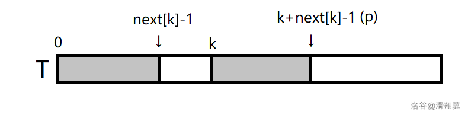
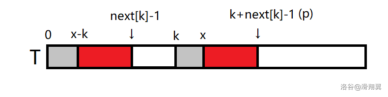
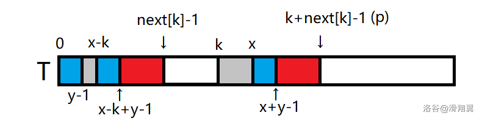
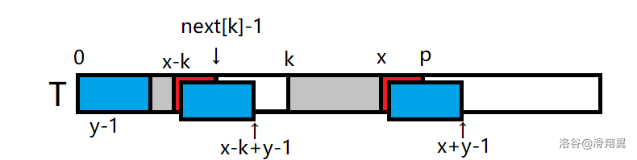
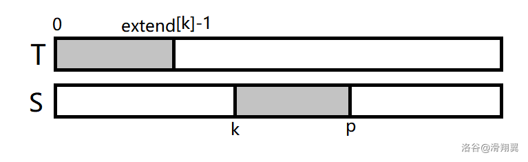
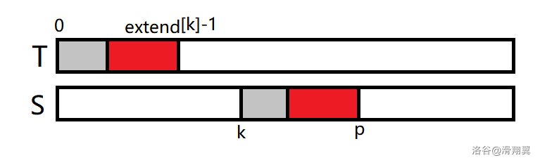
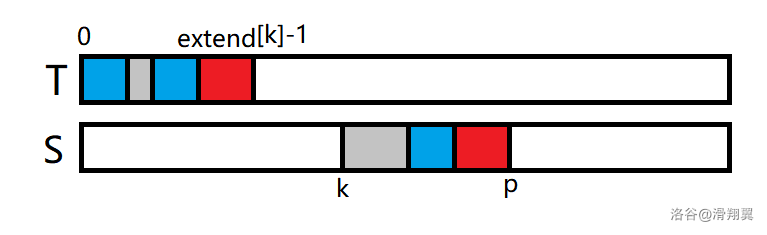

0

{sep}

</>

<topic>字符串匹配 解题报告</topic>

<subtopic><del>ABABC</del> -> SSC</subtopic>

</>

# 题意

**题目描述**

小 C 学习完了字符串匹配的相关内容，现在他正在做一道习题。

对于一个字符串 $S$，题目要求他找到 $S$ 的所有具有下列形式的拆分方案数：

$S = ABC$，$S = ABABC$，$S = ABAB \ldots ABC$，其中 $A$，$B$，$C$ 均是非空字符串，且 <red>$A$ 中出现奇数次的字符数量不超过 $C$ 中出现奇数次的字符数量。</red>

更具体地，我们可以定义 $AB$ 表示两个字符串 $A$，$B$ 相连接，例如 $A = \texttt{aab}$，$B = \texttt{ab}$，则 $AB = \texttt{aabab}$。

并递归地定义 $A^1=A$，$A^n = A^{n - 1} A$（$n \ge 2$ 且为正整数）。例如 $A = \texttt{abb}$，则 $A^3=\texttt{abbabbabb}$。

则小 C 的习题是求 $S = {(AB)}^iC$ 的方案数，其中 $F(A) \le F(C)$，$F(S)$ 表示字符串 $S$ 中出现奇数次的字符的数量。两种方案不同当且仅当拆分出的 $A$、$B$、$C$ 中有至少一个字符串不同。

小 C 并不会做这道题，只好向你求助，请你帮帮他。

# 样例

```
3
nnrnnr  -> 8
zzzaab  -> 9
mmlmmlo  -> 16
```

1. $A=\texttt{n}$，$B=\texttt{nr}$，$C=\texttt{nnr}$。
2. $A=\texttt{n}$，$B=\texttt{nrn}$，$C=\texttt{nr}$。
3. $A=\texttt{n}$，$B=\texttt{nrnn}$，$C=\texttt{r}$。
4. $A=\texttt{nn}$，$B=\texttt{r}$，$C=\texttt{nnr}$。
5. $A=\texttt{nn}$，$B=\texttt{rn}$，$C=\texttt{nr}$。
6. $A=\texttt{nn}$，$B=\texttt{rnn}$，$C=\texttt{r}$。
7. $A=\texttt{nnr}$，$B=\texttt{n}$，$C=\texttt{nr}$。
8. $A=\texttt{nnr}$，$B=\texttt{nn}$，$C=\texttt{r}$。

# 数据范围

<table>
    <thead>
        <tr>
            <th>测试点编号</th>
            <th>$\lvert S \rvert \le$</th>
            <th>特殊性质</th>
       	</tr>
    </thead>
	<tbody>
        <tr>
            <td>$1 \sim 8$</td>
            <td>$100$</td>
            <td>无</td>
        </tr>
        <tr>
            <td>$9 \sim 12$</td>
            <td>$1000$</td>
            <td>无</td>
        </tr>
        <tr>
            <td>$13 \sim 14$</td>
            <td>$2^{15}=32768$</td>
            <td>$S$ 中只包含一种字符</td>
        </tr>
	<tr>
            <td>$15 \sim 17$</td>
            <td>$2^{16}=65536$</td>
            <td>$S$ 中只包含两种字符</td>
        </tr>
	<tr>
            <td>$18 \sim 21$</td>
            <td>$2^{17}=131072$</td>
            <td>无</td>
        </tr>
        <tr>
            <td>$22 \sim 25$</td>
            <td>$2^{20}=1048576$</td>
            <td>无</td>
        </tr>
    </tbody>
</table>

对于所有测试点，保证 $1 \le T \le 5$，$1 \le |S| \le 2^{20}$。

# 题解

目录：

- 前言；
- 部分分 $32$ pts；
- 部分分 $48$ pts；
- 部分分 $48$ pts 的优化；
- 特殊性质 1 - $8$ pts；
- 特殊性质 2 - $12$ pts；
- 部分分 $84$ pts；
- 部分分 $86$ pts 与正解（by zzy）
- 扩展 KMP；
- 正解（扩展 KMP）$100$ pts；
- 正解（KMP）$100$ pts；

</img>

# 前言

<red>$A$ 中出现奇数次的字符数量不超过 $C$ 中出现奇数次的字符数量。</red>

务必好好理解这句话。

---

前置知识：

- 树状数组；
- 字符串哈希；
- Z 函数（扩展 KMP）；
- KMP。

~~相信大家都会树状数组和字符串哈希。扩展 KMP、KMP，相信大家也会。~~

{sep}

树状数组是啥？参见下面：

</>

<iframe src="https://yz-hs.github.io/dbd6ef846d33/" height="600px"></iframe>
</>

# 部分分 $32$ pts

相信大家都会。这是最暴力最暴力的解法。思路是，枚举 $A$ 的长度，再枚举 $B$ 的长度，然后枚举重复次数，直接暴力判断。

解释一下部分小函数的功能：

- `get(l,r,p)`：截取 $s[l,r]$，放到 $p$ 这个字符串中。
- `count(p)`：统计出现奇数次的字符数量（暴力统计）。
- `equal(p,q)`：判断 $p$ 和 $q$ 是否相等（逐位暴力判断）。

时间复杂度为 $O(n^3)$。看一下代码：

{sep}

```cpp
#include<bits/stdc++.h>
using namespace std;
namespace _yz
{
	typedef long long ll;
	const ll N=2000000+10,M=200+10;
	char S[N],A[N],B[N],C[N],tmp[N];
	ll n,b[M],ans=0;
	void cheat()
	{
		for(ll a=1;a<=n;a++)
		{
			for(ll b=1;b<=n;b++)
			{
				if(a+b>=n) break;
				get(1,a,A); get(a+1,a+b,B);
				get(a+b+1,n,C);
				if(count(A)<=count(C)) ans++;
				for(ll i=a+b;i<=n;i+=(a+b))
				{
					if(i+a+b>=n) break;
					get(i+1,i+a,tmp);
					if(equal(tmp,A)==0) break;
					get(i+a+1,i+a+b,tmp);
					if(equal(tmp,B)==0) break;
					get(i+a+b+1,n,C);
					if(count(A)>count(C)) continue;
					ans++;
				}
			}
		}
	}
	void main()
	{
		ll T;
		cin>>T;
		while(T--)
		{
			cin>>(S+1);
			n=strlen(S+1);
			ans=0;
			cheat();
			cout<<ans<<endl;
		}
		return;
	}
}
int main()
{
	_yz::main();
	return 0;
}
```
# 部分分 $48$ pts

$ABABC$？$SSC$！

我们把 $AB$ 合在一块枚举。显然这还是可以判断 $ABAB$ 这样的重复串的。接下来自然考虑如何满足奇数的限制。

定义一个数组 `cnt[i][a-z]` 表示 $s[1,i]$ 中每个字母出现的次数。这样就可以 $O(1)$ 得到一个字母在 $s[l,r]$ 中出现的次数。

定义一个数组 `t[i]` 表示对于一个字符串 $p$，出现奇数次的字母的个数在 $[1,i]$ 区间的前缀的数目。

这样，枚举 $AB$，得出它的 t 数组。然后枚举合法重复次数时统计贡献。如果一个重复次数合法，那么再考虑奇数限制。

把 $AB$ 分割成 $A$ 和 $B$。然后比较字符串 $A$ 和 $C$ 中出现奇数次的字符个数，合法则 `ans++`。实际上，我们已经处理出 $AB$ 的 t 数组，则 `t[C 中出现奇数次的字符个数]` 即为答案。

时间复杂度为 $O(n^2)$。下面是代码。

{sep}

```cpp
#include<bits/stdc++.h>
using namespace std;
namespace _yz
{
	typedef int ll;
	const ll N=1200000+10;
	struct Str{ll l,r;}C,AB,tmp;
	struct Cnt{ll b[30];}cnt[N]; 
	char S[N];
	ll n,ans=0,t[N];
	void init()
	{
		cin>>(S+1);
		n=strlen(S+1); ans=0;
		memset(cnt,0,sizeof(cnt));
		for(ll i=1;i<=n;i++)
		{
			cnt[i]=cnt[i-1];
			cnt[i].b[S[i]-'a'+1]++;
		}
	}
	void get(ll l,ll r,Str &g){g.l=l;g.r=r;}
	ll count(Str g)
	{
		ll jud=0;
		for(ll i=1;i<=26;i++)
		{
			ll ct=cnt[g.r].b[i]-cnt[g.l-1].b[i];
			if(ct%2==1) jud++;
		}
		return jud;
	}
	ll equal(Str g,Str h)
	{
		if(g.r-g.l!=h.r-h.l) return 0;
		for(ll i=0;i<=g.r-g.l;i++)
			if(S[g.l+i]!=S[h.l+i]) return 0;
		return 1;
	}
	void O(Str g){for(ll i=g.l;i<=g.r;i++) cout<<S[i];}
	void cheat()
	{
		for(ll i=2;i<=n-1;i++)
		{
			get(1,i,AB); get(i+1,n,C);
			for(ll j=0;j<=26;j++) t[j]=0;
			for(ll j=AB.l;j<=AB.r-1;j++)//此处减一小细节
				t[count((Str){AB.l,j})]++;
			for(ll j=0;j<=26;j++) t[j]+=t[j-1];
			ans+=t[count(C)];
			for(ll j=i;j<=n;j+=i)
			{
				if(j+i>=n) break;
				get(j+1,j+i,tmp);
				if(equal(AB,tmp)==0) break;
				get(j+i+1,n,C);
				ans+=t[count(C)];
			}
		}
	}
	void main()
	{
		ll T;
		cin>>T;
		while(T--)
		{
			init();
			cheat();
			cout<<ans<<endl;
		}
		return;
	}
}
int main()
{
	_yz::main();
	return 0;
}
```

# 部分分 $48$ pts 的优化

我们想更快地获取一个字符串中<red>出现奇数次的字母的个数</red>（这串字太难打了，把它按照题目中的记法，记为 $F(S)$ 吧）。

首先，题目中只要求 $F(A)\le F(C)$ 的限制。也就是说，对于任意 $l$ 不为 $1$，$r$ 不为 $n$ 的字符串 $S[l,r]$，它的 $F$ 值我们不用去管。

这启示我们可以搞一个类似于前缀和和后缀和的数组 `pre` 和 `suf`，用以记录各个前缀或后缀的 $F$ 值。这样，$F(C)$ 就等于 `suf[C 的左端点]`；t 数组处理也更加方便。

</>

<details>
    <summary>这里有一个 $O(n)$ 预处理的方法。</summary>
</>

以处理 `pre` 为例。假设我们知道 `pre[i]`，那怎么求 `pre[i+1]` 呢？显然，值要么加一，要么减一，因为显然每次只会改变一个字母。我们开一个桶数组，记录当前每个字母出现次数。如果当前字母的出现使得这个字母出现次数变为奇数，显然值加一；否则肯定是偶数，值必定减一。

</>

</details>

</>

然而还是只有 $48$ 分。

{sep}

不够快？再来个优化：树状数组！

显然，我们在每次循环中都把 t 数组清空。然后重新求前缀和。而且，只是因为多了一个字母而反复重新求。

用不到这么麻烦。

相信大家都知道了，这个过程很容易用**树状数组**来解决。

有个坑点。

<wshady>在 `update` 和 `query` 时，一定要加一！为什么？因为一个串的 $F$ 值可以是 $0$。</wshady>

时间复杂度为 $O(n^2)$。

{sep}

```cpp
#include<bits/stdc++.h>
using namespace std;
namespace _yz
{
	typedef int ll;
	const ll N=1200000+10,M=200;
	struct Str{ll l,r;}C,AB,tmp;
	char S[N];
	ll n,ans=0,b[M],pre[N],suf[N],t[M];
	
	ll lb(ll x){return x&-x;}
	void update(ll x){while(x<=27) t[x]++,x+=lb(x);}
	ll query(ll x)
	{
		ll ret=0;
		while(x) ret+=t[x],x-=lb(x);
		return ret;
	}
	
	void get(ll l,ll r,Str &g){g.l=l;g.r=r;}
	void init()
	{
		cin>>(S+1);
		n=strlen(S+1); ans=0;
		memset(b,0,sizeof(b));
		memset(t,0,sizeof(t));
		memset(pre,0,sizeof(pre));
		memset(suf,0,sizeof(suf));
		for(ll i=1;i<=n;i++)
		{
			b[S[i]]++; pre[i]=pre[i-1];
			if(b[S[i]]%2==1) pre[i]++;
			else pre[i]--;
		}
		memset(b,0,sizeof(b));
		for(ll i=n;i>=1;i--)
		{
			b[S[i]]++; suf[i]=suf[i+1];
			if(b[S[i]]%2==1) suf[i]++;
			else suf[i]--;
		}
	}
	ll equal(Str g,Str h)
	{
		if(g.r-g.l!=h.r-h.l) return 0;
		for(ll i=0;i<=g.r-g.l;i++)
			if(S[g.l+i]!=S[h.l+i]) return 0;
		return 1;
	}
	void O(Str g){for(ll i=g.l;i<=g.r;i++) cout<<S[i];}
	void cheat()
	{
		for(ll i=2;i<=n-1;i++)
		{
			get(1,i,AB); get(i+1,n,C);
			update(pre[i-1]+1);
			ans+=query(suf[C.l]+1);
			for(ll j=i;j<=n;j+=i)
			{
				if(j+i>=n) break;
				get(j+1,j+i,tmp);
				if(equal(AB,tmp)==0) break;
				get(j+i+1,n,C);
				ans+=query(suf[C.l]+1);
			}
		}
	}
	void main()
	{
		ll T;
		cin>>T;
		while(T--)
		{
			init();
			cheat();
			cout<<ans<<endl;
		}
		return;
	}
}
int main()
{
	_yz::main();
	return 0;
}
```

# 特殊性质 1 - $8$ pts

特殊性质 1。只有一种字母。

这说明什么？

我们不用判断两个字符串是否相等了。大大降低时间复杂度。

只需要在上一份代码的基础上：

```cpp
	void cheat()
	{
		for(ll i=2;i<=n-1;i++)
		{
			get(1,i,AB); get(i+1,n,C);
			update(pre[i-1]+1);
			ans+=query(suf[C.l]+1);
			for(ll j=i;j<=n;j+=i)
			{
				if(j+i>=n) break;
				get(j+1,j+i,tmp);
				//if(equal(AB,tmp)==0) break; 注释掉一行
				get(j+i+1,n,C);
				ans+=query(suf[C.l]+1);
			}
		}
	}
```

$8$ 分到手。

# 特殊性质 1 - $8$ pts

这里还有一个 $O(n)$ 做法。

既然 $S$ 中只包含一种字符，那么可以：

枚举 $AB$ 的长度，那么剩下的长度为 $C$。

- 如果 $C$ 的长度为奇数，那么 $A$ 的长度随意。
- 如果 $C$ 的长度为偶数，那么 $A$ 的长度也为偶数。

分好类计算即可。每次 $O(1)$ 计算，总复杂度 $O(n)$。

{sep}

```cpp
#include<bits/stdc++.h>
using namespace std;
namespace _yz
{
	typedef int ll;
	const ll N=1200000+10; 
	char S[N];
	ll n,ans=0,rpt;
	void init()
	{
		cin>>(S+1);
		n=strlen(S+1); ans=0;
	}
	ll odd(ll C)//统计 AB 为奇数时的合法 C 数 
	{
		if(C%2)
		{
			if(rpt%2==0) return rpt/2;
			else return rpt/2+1;
		}
		else
		{
			if(rpt%2==0) return rpt/2;
			else return rpt/2;
		}
	}
	void cheat()
	{
		ll C,rep;
		for(ll AB=2;AB<=n-1;AB++)
		{
			C=n-AB;
			if(C%AB==0) rpt=C/AB;
			else rpt=C/AB+1;
			if(AB%2) ans+=((AB-1)/2)*rpt+((AB-1)-(AB-1)/2)*odd(C);
			else if(C%2) ans+=(AB-1)*rpt;
			else ans+=((AB-1)/2)*rpt;
		}
	}
	void main()
	{
		ll T;
		cin>>T;
		while(T--)
		{
			init();
			cheat();
			cout<<ans<<endl;
		}
		return;
	}
}
int main()
{
	_yz::main();
	return 0;
}
```

</img>

# 特殊性质 2 - $12$ pts

$S$ 中只包含两种字符。

这启示我们什么？

~~反正对我没启示。不知道这个特殊性质怎么用。~~

算了，让我们看看 $84$ 分的部分分吧。

</img>

# 部分分 $84$ pts

之前我们的 `equal(p,q)` 都是这样写的：

```cpp
ll equal(Str g,Str h)
{
	if(g.r-g.l!=h.r-h.l) return 0;
	for(ll i=0;i<=g.r-g.l;i++)
		if(S[g.l+i]!=S[h.l+i]) return 0;
	return 1;
}
```

或这样（$32$ pts）：

```cpp
ll equal(char *g,char *h)
{
	ll len=strlen(g+1);
	if(len!=strlen(h+1)) return 0;
	for(ll i=1;i<=len;i++)
		if(g[i]!=h[i]) return 0;
	return 1;
}
```

这是 $O(n)$ 的，太慢了。显然，判断 AB 重复次数是瓶颈所在。~~那如何突破瓶颈期呢？~~使用字符串哈希吧。利用可减性，$O(n)$ 预处理，$O(1)$ 判断。总时间复杂度降为 $O(n \ln n)$（无穷级数求和）。本代码使用自然溢出哈希。下面是代码。

{sep}

```cpp
#include<bits/stdc++.h>
using namespace std;
namespace _yz
{
	typedef long long ll;
	const ll N=1200000+10,M=200,base=131;
	struct Str{ll l,r;}C,AB,tmp;
	char S[N];
	ll n,ans=0,b[M],pre[N],suf[N],t[M];
	unsigned long long hash[N],power[N];
	
	ll lb(ll x){return x&-x;}
	void update(ll x){while(x<=27) t[x]++,x+=lb(x);}
	ll query(ll x)
	{
		ll ret=0;
		while(x) ret+=t[x],x-=lb(x);
		return ret;
	}
	
	void get(ll l,ll r,Str &g){g.l=l;g.r=r;}
	void init()
	{
		cin>>(S+1);
		n=strlen(S+1); ans=0;
		memset(b,0,sizeof(b));
		memset(t,0,sizeof(t));
		memset(pre,0,sizeof(pre));
		memset(suf,0,sizeof(suf));
		memset(hash,0,sizeof(hash));
		for(ll i=1;i<=n;i++)
		{
			b[S[i]]++; pre[i]=pre[i-1];
			if(b[S[i]]%2==1) pre[i]++;
			else pre[i]--;
			
			hash[i]=hash[i-1]*base+S[i];
		}
		memset(b,0,sizeof(b));
		for(ll i=n;i>=1;i--)
		{
			b[S[i]]++; suf[i]=suf[i+1];
			if(b[S[i]]%2==1) suf[i]++;
			else suf[i]--;
		}
	}
	ll equal(Str g,Str h)
	{
		if(g.r-g.l!=h.r-h.l) return 0;
		ll d=h.l-g.l;
		if((hash[g.r]-hash[g.l-1])*power[d]!=hash[h.r]-hash[h.l-1]) return 0;
		return 1;
	}
	void O(Str g){for(ll i=g.l;i<=g.r;i++) cout<<S[i];}
	void cheat()
	{
		for(ll i=2;i<=n-1;i++)
		{
			get(1,i,AB); get(i+1,n,C);
			update(pre[i-1]+1);
			ans+=query(suf[C.l]+1);
			for(ll j=i;j<=n;j+=i)
			{
				if(j+i>=n) break;
				get(j+1,j+i,tmp);
				if(equal(AB,tmp)==0) break;
				get(j+i+1,n,C);
				ans+=query(suf[C.l]+1);
			}
		}
	}
	void main()
	{
		ll T;
		cin>>T; 
		power[0]=1;
		for(ll i=1;i<=N-10;i++) power[i]=power[i-1]*base;
		while(T--)
		{
			init();
			cheat();
			cout<<ans<<endl;
		}
		return;
	}
}
int main()
{
	_yz::main();
	return 0;
}
```

# 部分分 $86$ pts 与正解（by zzy）

~~yz 讲了我的预处理优化这里不再说了。~~算了稍微说说吧。

假设 `pre` 和 `suf` 已求出，注意到只有 $26$ 个字母所以只记录下奇数的 `pre` 和 `suf` 均 $\le26$。

先不考虑题中的出现奇数次这个条件。先考虑把 $S$ 拆成 $(AB)^kC$ 的方案数，其中 $AB$ 合起来是一个循环。

考虑循环节长度：不妨设循环节长度为 $i$，第一个发现是，只要满足 $2 \leq i \leq n-1$ 都可以。因为 $A$ 和 $B$ 都不能为空，所以循环节长度至少是 $2$。循环节长度最多是 $n-1$，因为 $C$ 也不能为空。

枚举一下循环节的长度 $i$，Z 函数告诉我们的是除去开头串与开头串匹配的长度，而我们需要知道的是循环区段的个数（后面要用到，前面 yz 应该讲了），那么对于一个 $k$ 总的方案数就是 $z(i)/i+1$。

注意细节，如果 $z(i) + i = n$ 则因为 $C$ 不为空，从而实际循环结长度少 $1$ (`--z[i]`)。

{sep}

假设现在枚举到循环节长度为 $i$，此时根据前面的结论，我们算出来 $k$ 的方案数有 $t$ 种。其中一半 $k$ 是奇数，一半$k$ 是偶数。当然奇数可能比偶数多一个。不妨设 $k$ 是奇数的取值方案数是 $t_j$，那么有 $t_j = t-t/2$，同理设偶数的 $k$ 的个数是 $t_o$，有 $t_o = t/2$。

- 如果 $k$ 的值是奇数，那总的 $C$ 字符串出现奇数的字符次数就等于总字符串的出现奇数的字符次数。
- 如果 $k$ 的值是偶数，那每两个 $AB$ 就会抵消贡献，最后一定是只有一个 $AB$ 在贡献，所以 $C$ 字符串的出现奇数的字符次数也都相等。

所以我们就可以用乘法原理，将 $t_j \times( 1$ 到 $i-1$ 所有能产生贡献的 $A$ 串的个数 $) + t_o \times( 1$ 到 $i-1$ 所有能产生贡献的 $A$ 串的个数 $)$。

从这儿打个暴力就有 $86$ 分 $O(26n)$。

{sep}

考虑用权值树状数组来维护（注意树状数组下标不能从 $0$ 开始）。

考虑记录 $A$ 查询 $C$，这样做的好处相当于是使得计数满足线性递推关系，所以我们不记录 $C$ 查 $A$ 了，那样顶多$86$（虽然好写）。

由于 $F(A)\le F(C)$，所以在外层循环枚举 $AB$ 长度时，因为后对 $AB$ 长度的 $A$ 统计贡献一定会包含此次 $AB$，所以对 $AB$ 长度的奇数次字符进行 `update` 到树状数组里面，统计 $C$ 贡献时再 `ask` $F(C)$，`ask` 刚好管到不比自己多的所有可行的 $A$，将所得的结果累计加和到 ans 里面。

则 ans 就是我们想要的了。

# 扩展 KMP

Z 函数，又称为扩展 KMP 算法。那什么是扩展 KMP 呢？请看例题：

</>
<iframe src="https://www.luogu.com.cn/problem/P5410" height="600px"></iframe>
</>

# 扩展 KMP

<red>仅在讲解 exKMP 过程中</red>，约定字符串下标<red>从 $0$ 开始</red>。

对于一个长度为 $n$ 的字符串 $s$。定义函数 $z(i)$ 表示 $s$ 和 $s[i,n-1]$（即以 $s_i$ 开头的后缀）的最长公共前缀（LCP）的长度。$z$ 被称为 $s$ 的 Z 函数。

扩展 KMP：求出字符串 $S$ 的所有后缀与 $T$ 的最长公共前缀长度（一般存到名为 `ext` 的数组中），时间复杂度 $\mathcal{O}(|S|+|T|)$。该解法思想与 KMP 类似，所以称作扩展 KMP。

本算法需要先求解 $T$ 的 Z 函数。

# 扩展 KMP――求 Z 函数

参考题解：[https://www.cnblogs.com/zeno6174/p/15058525.html](https://www.cnblogs.com/zeno6174/p/15058525.html)。

<red>注意：参考题解有些许错误，这里已经更正。</red>

定义 $next_i$ 为 $T$ 由 $i$ 开始的后缀与 $T$ 的最长公共前缀长度（此即为 Z 函数）。

显然 $next_0=|T|$。设 $n=|T|$。考虑求出了 $next_{0\cdots x-1}$，现在要求 $next_x$。

设 $k$ 为使 $j+next_j-1(0\le j\lt x)$ 取最大值的 $j$，$p=k+next_k-1$，也就是左边那一坨式子的最大值。

根据定义，可得 $T$ 的前缀 $T[0,next_k-1]=T[k,n]$ 的前缀 $T[k,p]$。

$T[k,p]$ 被称为 $k$ 的**匹配段**，或 Z-box。



{sep}

我们在 $T[k,p]$ 中把 $T[x,p]$ 标注出来，因为两段灰色部分相同，可以在第一段里找到相同的位置 $T[x-k,next_k-1]$。



我们找到 $next_{x-k}$，记作 $y$。由于 Z 函数的定义，$T[0,y-1]=T[x-k,x-k+y-1]$，在右边的灰色部分，也有一段和它完全一样的 $T[x,x+y-1]$。把它们画为蓝色。接下来需要分类讨论。

情况一：蓝色部分**小于**（<red>没有等于</red>）红色部分，此时确定 $next_x=y$（反证法）。



{sep}

情况二：蓝色部分**大于等于**红色部分，此时发现 $x+y-1$ 已经超过了我们目前去到的最远的地方，因此从 $p+1$ 以及 $p-x+1$（就是第一段蓝色中位置大于红色长度的那一部分）开始一位一位比，算出真正的 $next_x$（记得要更新 $k$ 和 $p$）。



时间复杂度？感性理解：

$p$ 是我们当前已匹配到最远的位置，情况一 $k$ 不会变，情况二 $k$ 会变大，$k$ 保持不降，时间复杂度 $\mathcal O(|T|)$。

</img>

{sep}

让我们看一个小动画。

---

</>
<iframe src="https://personal.utdallas.edu/~besp/demo/John2010/z-algorithm.htm" height="900px"></iframe>
</>

行了呗！来来来！看看怎么搞 `ext`！

# 扩展 KMP――求 `ext`

其实和求 Z 函数几乎没有区别。

还是考虑求出了 $ext_{0\cdots x-1}$，现在求 $ext_x$。还是定义 $k$，$p$（和前文一致，把 `next` 换成 `ext`）。



在图中画出 $x$，$x-k$，标红色。



{sep}

定义 $y=next_{x-k}$，标出相同的三段蓝色。



这时还是可以分为两种情况。蓝色部分小于红色部分，则 $ext_x=y$，否则需要从 $p+1$,$p-x+1$ 开始一一比对确定 $ext_x$。

由于此时的 $k$ 不降，时间复杂度 $\mathcal O(|S|)$。

下面上代码：

</img>

{sep}

```cpp
#include<bits/stdc++.h>
using namespace std;
namespace _yz
{
	typedef long long ll;
	const ll N=20000000+10; 
	char a[N],b[N];
	ll n,m,z[N],ext[N],ans;
	void exKMP()
	{
		ll k=1; n=strlen(b); z[0]=n;
		for(ll i=0;i+1<=n-1&&b[i]==b[i+1];z[1]=i+1,i++);
		for(ll i=2;i<=n-1;i++)
		{
			ll p=k+z[k]-1,y=z[i-k];
			if(i+y-1<p) z[i]=y;
			else
			{
				for(
					ll j=z[i]=max(p-i+1,0ll);
					i+j<=n-1&&b[i+j]==b[j];
					z[i]=j+1,k=i,j++
				);
			}
		}
	}
	void getext()
	{
		ll k=0; m=strlen(a);
		for(ll i=0;i<=min(n,m)-1&&a[i]==b[i];ext[0]=i+1,i++);
		for(ll i=1;i<=m-1;i++)
		{
			ll p=k+ext[k]-1,y=z[i-k];
			if(i+y-1<p) ext[i]=y;
			else
			{
				for(
					ll j=ext[i]=max(p-i+1,0ll);
					i+j<=m-1&&j<=n-1&&a[i+j]==b[j];
					ext[i]=j+1,k=i,j++
				);
			}
		}
	}
	void main()
	{
		cin>>a>>b;
		exKMP(); getext();
		for(ll i=0;i<=n-1;i++) ans^=(i+1)*(z[i]+1);
		printf("%lld\n",ans); ans=0;
		for(ll i=0;i<=m-1;i++) ans^=(i+1)*(ext[i]+1);
		printf("%lld\n",ans);
		return;
	}
}
int main()
{
	_yz::main();
	return 0;
}
```

# 正解（扩展 KMP）$100$ pts

好了，现在我们有了 Z 函数了。那怎么搞正解？ 

Z 函数是啥？ 一个字符串和其后缀的 LCP 的长度。我们的算法瓶颈还是在判断 $AB$ 重复次数上（$O(\ln n)$）。看来只能把它变成 $O(1)$ 了。怎么办？

</>
<details>
    <summary>当然是利用 Z 函数了。</summary>
</>

设一个字符串为 $S$。要判断 $AB$ 重复几次，首先获取 $AB$ 的长度，设为 $i$。看 $S$ 和 $S[i+1,n]$ 的 LCP 的长度，也就是 $z(i+1)$。显然，重复的次数就是 $1+\dfrac{z(i+1)}{i}$。

注意：如果 $i+1+z(i+1)-1=n$（也就是其 LCP 到达了字符串末尾），且 $i\mid n$，则重复次数减一（分给 $C$）。 

~~现在请你们尝试把 exKMP 改成字符串从 ~~$1$~~ 索引，检验你们对 exKMP 的理解。~~

</>
</details>
</>

现在我们知道怎么求重复次数了，但怎么满足限制 $F$？

{sep}

我们来看一个显然的东西：奇数 $\times$ 奇数 $=$ 奇数，奇数 $\times$ 偶数 $=$ 偶数。

这说明什么？$F((AB)^{2n}C)=F(C)$，$F((AB)^{2n+1}C)=F(ABC)$。（注：记号参照题面）

也就是说，我们计算出重复次数，然后结合前面的树状数组优化，就可以 $O(\log26)$ 计算一个 $AB$ 的贡献。

这样，我们得出了 $O(n\log26)$，也就是 $O(n)$ 的解。

下面上代码。

如果觉得听不懂，可以让 zzy [再讲一遍](#page21)。

</img>

{sep}

```cpp
#include<bits/stdc++.h>
using namespace std;
namespace _yz
{
	typedef long long ll;
	const ll N=1200000+10,M=200;
	struct Str{ll l,r;}C,AB,tmp;
	char S[N];
	ll n,ans=0,b[M],pre[N],suf[N],t[M],z[N];
	
	ll lb(ll x){return x&-x;}
	void update(ll x){while(x<=27) t[x]++,x+=lb(x);}
	ll query(ll x)
	{
		ll ret=0;
		while(x) ret+=t[x],x-=lb(x);
		return ret;
	}
	
	void exKMP()
	{
		ll k=2; z[1]=n;
		for(ll i=1;i+1<=n&&S[i]==S[i+1];z[2]=i,i++);
		for(ll i=3;i<=n;i++)
		{
			ll p=k+z[k]-1,y=z[i-k+1];
			if(i+y-1<p) z[i]=y;
			else
			{
				z[i]=max(p-i+1,0ll);
				for(
					ll j=max(p-i+2,1ll);
					i+j-1<=n&&S[i+j-1]==S[j];
					z[i]=j,k=i,j++
				);
			}
		}
	}
	ll getrpt(Str AB,Str C)
	{
		ll i=AB.r;
		ll ret=z[i+1]/i+1;
		if(i+1+z[i+1]-1==n&&n%i==0) return ret-1;
		else return ret;
	}
	
	void get(ll l,ll r,Str &g){g.l=l;g.r=r;}
	void init()
	{
		cin>>(S+1);
		n=strlen(S+1); ans=0;
		memset(b,0,sizeof(b));
		memset(t,0,sizeof(t));
		memset(pre,0,sizeof(pre));
		memset(suf,0,sizeof(suf));
		memset(z,0,sizeof(z));
		for(ll i=1;i<=n;i++)
		{
			b[S[i]]++; pre[i]=pre[i-1];
			if(b[S[i]]%2==1) pre[i]++;
			else pre[i]--;
		}
		memset(b,0,sizeof(b));
		for(ll i=n;i>=1;i--)
		{
			b[S[i]]++; suf[i]=suf[i+1];
			if(b[S[i]]%2==1) suf[i]++;
			else suf[i]--;
		}
	}
	void O(Str g){for(ll i=g.l;i<=g.r;i++) cout<<S[i];}
	void solve()
	{
		for(ll i=2;i<=n-1;i++)
		{
			ll rpt,a1=0,a2=0;
			get(1,i,AB); get(i+1,n,C);
			update(pre[i-1]+1);
			rpt=getrpt(AB,C);
			
			get(i*(rpt-1)+1,n,C);
			if(rpt!=1) a1=query(suf[C.l]+1);//ABC 
			get(i*rpt+1,n,C);
			a2=query(suf[C.l]+1);//C
			if(rpt%2==0) ans+=(rpt/2)*(a1+a2);//ABABABABC
			else ans+=(rpt/2)*a1+(rpt-rpt/2)*a2;//ABABABC
		}
	}
	void main()
	{
		ll T;
		cin>>T;
		while(T--)
		{
			init();
			exKMP();
			solve();
			cout<<ans<<endl;
		}
		return;
	}
}
int main()
{
	_yz::main();
	return 0;
}
```

{sep}


<wshady class="big">别急！还没完！</wshady> 

# 正解（KMP）$100$ pts

无非就是求解字符串重复次数的方法不同。这里用普通的 KMP 求解字符串重复次数。

我们都知道，Len $-$ Lborder $=$ 最小循环节。因此，我们可以通过 KMP 的 `nxt` 数组，求一个字符串的最小循环节。

如果最小循环节 $s$ 求出，那么 $s$ 的重复次数易求，$s^i$ 同样易求。

我们从 $n-1$ 开始从后往前枚举整个字符串。如果找到了某个字符串的最小循环节 $p$，那么这个字符串一定是 $p$ 复制最多次形成的。这样就求出了 $p$ 的重复次数。

之后，如果再求出的某个字符串的最小循环节也是 $p$，那么这个字符串必定可表示为 $p^i$，这时候 $p^i$ 的重复次数也求出来了。

如果一个字符串不是任何字符串的循环节，那么它的重复次数就是 $1$。

这样，我们就求出了任意字符串的重复次数。其余的和上一个正解解法相同。

下面是代码。

{sep}

```cpp
#include<bits/stdc++.h>
using namespace std;
namespace _yz
{
	typedef long long ll;
	const ll N=1200000+10,M=200;
	struct Str{ll l,r;}C,AB,tmp;
	char S[N];
	ll n,ans=0,b[N],pre[N],suf[N],t[M],nxt[N],r[N];
	
	ll lb(ll x){return x&-x;}
	void update(ll x){while(x<=27) t[x]++,x+=lb(x);}
	ll query(ll x)
	{
		ll ret=0;
		while(x) ret+=t[x],x-=lb(x);
		return ret;
	}
	
	void KMP()
	{
		memset(b,0,sizeof(b));
		memset(nxt,0,sizeof(nxt));
		ll j=nxt[0]=nxt[1]=0;
		for(ll i=2;i<=n-1;i++)
		{
			while(j&&S[i]!=S[j+1]) j=nxt[j];
			if(S[i]==S[j+1]) j++;
			nxt[i]=j;
		}
		for(ll i=n-1;i>=1;i--)
		{
			ll e=i-nxt[i];
			if(i%e) continue;
			if(r[e]==1) r[e]=i/e;
			else if(r[i]==1) r[i]=r[e]/(i/e);
		}
	}
	
	void get(ll l,ll r,Str &g){g.l=l;g.r=r;}
	void init()
	{
		cin>>(S+1);
		n=strlen(S+1); ans=0;
		memset(b,0,sizeof(b));
		memset(t,0,sizeof(t));
		memset(pre,0,sizeof(pre));
		memset(suf,0,sizeof(suf));
		for(ll i=1;i<=n;i++)
		{
			b[S[i]]++; pre[i]=pre[i-1];
			if(b[S[i]]%2==1) pre[i]++;
			else pre[i]--; r[i]=1;
		}
		memset(b,0,sizeof(b));
		for(ll i=n;i>=1;i--)
		{
			b[S[i]]++; suf[i]=suf[i+1];
			if(b[S[i]]%2==1) suf[i]++;
			else suf[i]--;
		}
	}
	void O(Str g){for(ll i=g.l;i<=g.r;i++) cout<<S[i];}
	void solve()
	{
		for(ll i=2;i<=n-1;i++)
		{
			ll rpt,a1=0,a2=0;
			get(1,i,AB); get(i+1,n,C);
			update(pre[i-1]+1);
			rpt=r[i];
			get(i*(rpt-1)+1,n,C);
			if(rpt!=1) a1=query(suf[C.l]+1);//ABC 
			get(i*rpt+1,n,C);
			a2=query(suf[C.l]+1);//C
			if(rpt%2==0) ans+=(rpt/2)*(a1+a2);//ABABABABC
			else ans+=(rpt/2)*a1+(rpt-rpt/2)*a2;//ABABABC
		}
	}
	void main()
	{
		ll T;
		cin>>T;
		while(T--)
		{
			init();
			KMP();
			solve();
			cout<<ans<<endl;
		}
		return;
	}
}
int main()
{
	_yz::main();
	return 0;
}
```

{sep}


<wshady class="big">我保证，这次真完了。</wshady> 

{sep}

<bg style="background-color: black"></bg>

</>

<topic class="red"><wshady>感谢大家的聆听！</wshady></topic>

</>